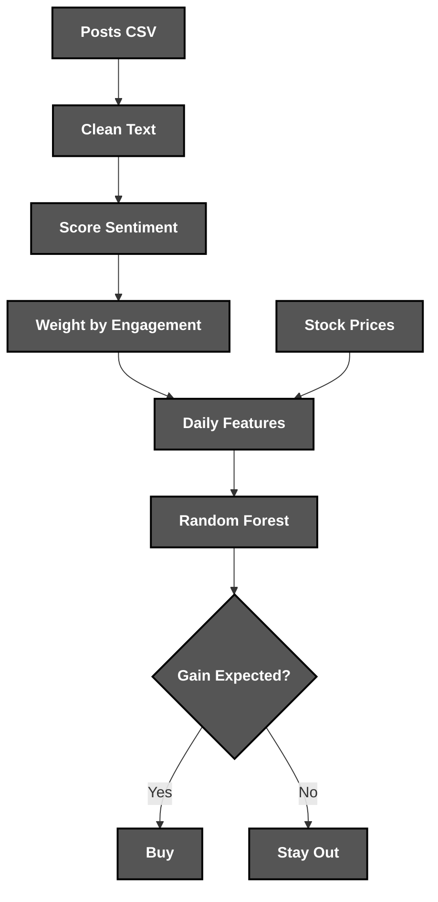
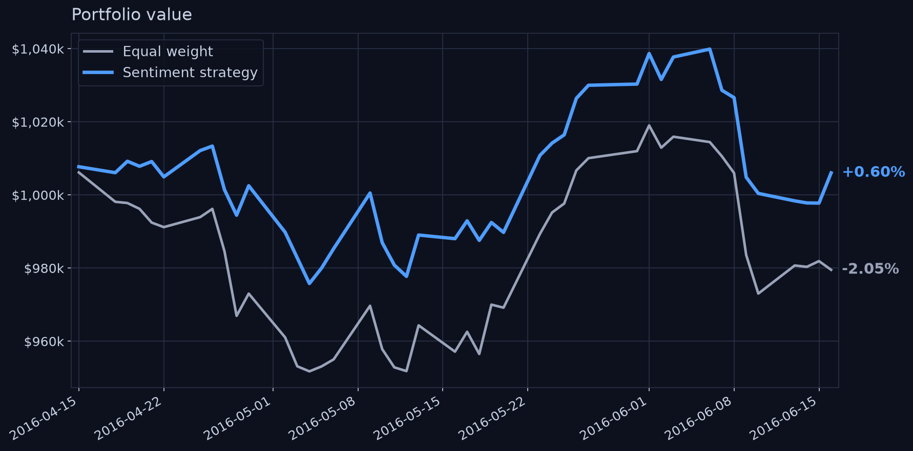

<div align="center">


*A backtested **trading strategy** driven by social **sentiment***

</div>

# 📝 **Description**

<div align="center">

***Sentiment Trader*** is a **trading research tool** that scores posts about any stock with ***VADER***, ***Naive Bayes*** or ***BERT*** and backtests a ***Random Forest*** strategy against the market
</div>
<br>
<div align="right">

***It was born as a fourth-year university project*** 🎓

</div>

# 🛠️ **Sentiment Trader Architecture & Workflow**

<div align="center">


</div>

# 📁 **Project Structure**

```
sentiment-trader/
├── .gitattributes                                      # Git Attributes Configuration
├── .gitignore                                          # Git Ignore Rules
├── LICENSE                                             # Project License
├── pyproject.toml                                      # Package & Tool Configuration
├── README.md                                           # You are here! ⬅️
│
├── .github/workflows/
│   └── ci.yml                                          # Lint & Test Pipeline
│
├── assets/                                             # Visual Assets
│   ├── backtest.png                                    # Backtest Chart
│   └── logo.png                                        # Project Logo
│
├── examples/
│   └── sample_posts.csv                                # Illustrative Input Posts
│
├── src/sentiment_trader/
│   ├── cli.py                                          # Command-Line Interface
│   ├── text.py                                         # Finance Text Cleaning
│   ├── sentiment.py                                    # VADER, Naive Bayes & BERT Models
│   ├── evaluation.py                                   # Model Accuracy Comparison
│   ├── features.py                                     # Daily Signals & Price Changes
│   ├── prices.py                                       # Yahoo Finance & CSV Prices
│   ├── backtest.py                                     # Random Forest Strategy & Metrics
│   ├── plotting.py                                     # Equity Curve Charts
│   │
│   └── data/
│       ├── labelled_tweets.csv                         # 5,791 Labelled Finance Tweets
│       └── nasdaq_2016_features.csv                    # 82 NASDAQ Stocks, Mar–Jun 2016
│
└── tests/                                              # Unit & Regression Tests
```

# 🔧 **Installation**

## 📋 Requirements

- **Python 3.10+**

## ⚙️ Quick Setup

1. **Clone the repository**
   ```bash
   git clone https://github.com/cristiangilsanz/sentiment-trader.git
   cd sentiment-trader
   ```

2. **Create a virtual environment** *(recommended)*
   ```bash
   python -m venv .venv
   source .venv/bin/activate      # Windows: .venv\Scripts\activate
   ```

3. **Install the toolkit**
   ```bash
   pip install -e .
   ```

4. **Add live prices and transformer models** *(optional)*
   ```bash
   pip install -e ".[prices,transformers]"
   ```

<br>

# 🚀 **See *Sentiment Trader* in Action**

## 📈 To Run the Backtest:

1. **Backtest the bundled NASDAQ 2016 signals:**

```bash
sentiment-trader backtest --plot equity.png
```

2. **It trains on data before 15 April 2016 and trades the rest:**

```
                      Strategy    Equal weight
Final capital     1,006,028.63      979,535.07
Total return             0.60%          -2.05%
Sharpe ratio              0.33           -0.81
Max drawdown            -4.05%          -5.40%
Hit rate 49.2%, losing picks 20.1%
```

3. **Repeat it over 50 random seeds to check how robust it is:**

```bash
sentiment-trader backtest --seeds 50
```

```
Seeds                 50
Beats equal weight    48 / 50
Median return         0.69%  (range -3.00% to 2.18%)
Median Sharpe ratio   0.35
Equal weight return   -2.05%
```

The strategy beats the market on almost every seed, but its hit rate stays around 49%, so the edge comes from sitting out bad days rather than picking winners.

## 🧠 To Compare Sentiment Models:

1. **Evaluate the models on the labelled tweets:**

```bash
sentiment-trader evaluate --models vader,naive-bayes,finbert
```

## 🔁 To Use Your Own Data:

1. **Score your posts, build daily features with live prices and backtest them:**

```bash
sentiment-trader score examples/sample_posts.csv scored.csv --model vader
sentiment-trader features scored.csv features.csv
sentiment-trader backtest --features features.csv --split-date 2024-05-01
```

## 🧪 To Run the Tests:

1. **Install the development tools:**

```bash
pip install -e ".[dev]"
```

2. **Run the tests and the linter:**

```bash
pytest
ruff check .
```

# 📊 **Backtest**

<div align="center">
    
</div>

<br>

## ⌨️ Commands

<div align="center">

| Command | Action | Description |
|:---:|---|---|
| `evaluate` | Compare Models | Measures each model's accuracy on labelled texts |
| `score` | Score Posts | Adds a sentiment label to every post in a CSV |
| `features` | Build Features | Turns posts into daily signals and joins prices |
| `backtest` | Run Backtest | Trains the strategy and compares it with the market |

</div>

## 📄 Input Format

<div align="center">

| Column | Required | Description |
|:---:|:---:|---|
| `ticker` | Yes | Stock symbol the post talks about |
| `datetime` | Yes | Time the post was published |
| `text` | Yes | Content of the post |
| `followers` | No | Author's followers, used to weight the post |
| `retweets` | No | Post's shares, used to weight the post |

</div>

# 🧠 **Sentiment Models**

The following table compares the models on the same held-out 20% of the labelled tweets:

<div align="center">

| Model | Accuracy | Training |
|---|---|---|
| VADER | 67.13% | None |
| TF-IDF + Naive Bayes | 68.68% | Under a minute |
| FinBERT | 69.89% | None |
| Fine-tuned BERT | 80.41% | About 45 minutes on a CPU |

</div>

# 💡 **Tips for Best Results**

Sentiment signals get stronger with more posts per stock and day, so prefer busy tickers and long periods.

**Examples of a great run:**

> - Compare ***FinBERT*** with the classic models on your own labelled texts.
> - Score ***news headlines*** or ***Reddit posts*** instead of tweets.
> - Move the ***split date*** to test the strategy in other market phases.

# 📚 **Tech Stack & Other Resources**

## 📦 Tech Stack

### 🧩 **Programming Language**
- [Python](https://docs.python.org/3/)

### 🤖 **Machine Learning**
- [scikit-learn](https://scikit-learn.org/stable/)
- [Hugging Face Transformers](https://huggingface.co/docs/transformers)
- [PyTorch](https://pytorch.org/docs/)

### 🗣️ **Sentiment Analysis**
- [VADER](https://github.com/cjhutto/vaderSentiment)
- [FinBERT](https://huggingface.co/ProsusAI/finbert)

### 📊 **Data & Visualisation**
- [pandas](https://pandas.pydata.org/docs/)
- [NumPy](https://numpy.org/doc/)
- [yfinance](https://ranaroussi.github.io/yfinance/)
- [Matplotlib](https://matplotlib.org/stable/)

### 🧪 **Testing**
- [Pytest](https://docs.pytest.org/)

### 🧹 **Code Quality**
- [Ruff](https://docs.astral.sh/ruff/)

### ⚙️ **Continuous Integration**
- [GitHub Actions](https://docs.github.com/actions)

# 🙏 **Credits & Thanks**

This project was created on my own in my fourth year of university 🤝.

Thanks to *C.J. Hutto* and *Eric Gilbert* for ***VADER***, to *Prosus AI* for ***FinBERT***, to the authors of the [*Stock-Market Sentiment Dataset*](https://www.kaggle.com/datasets/yash612/stockmarket-sentiment-dataset) for the labelled tweets, and to *FollowTheHashtag* for the NASDAQ 100 tweets behind the 2016 signals ✨.

# 📄 **License**

This project is licensed under the MIT License - see the [LICENSE](LICENSE) file for details.

# 📞 **Get Help & Connect**

- 🐛 [Open an issue](https://github.com/cristiangilsanz/sentiment-trader/issues)
- 📧 cristiangilsanz@gmail.com

<div align="center">
  <br>

  **Made with 💖 for the Quant Community**

  [⭐ Star this repo](https://github.com/cristiangilsanz/sentiment-trader) | [🍴 Fork it](https://github.com/cristiangilsanz/sentiment-trader/fork)

  <br>

  <a href="https://www.buymeacoffee.com/cristiangilsanz" target="_blank">
    
  </a>

</div>
